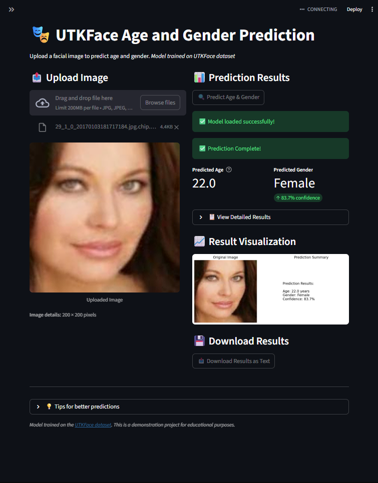

# 🎭 Age and Gender Prediction

A deep learning-based application that predicts age and gender from facial images using the UTKFace dataset. The project features a multi-task CNN model and a Streamlit web interface.


## 📋 Table of Contents
- [Features](#features)
- [Demo](#demo)
- [Installation](#installation)
- [Usage](#usage)
- [Project Structure](#project-structure)
- [Model Architecture](#model-architecture)
- [Dataset](#dataset)
- [Results](#results)
- [Deployment](#deployment)
- [Acknowledgments](#acknowledgments)

## ✨ Features

- **Multi-task Learning**: Simultaneous age regression and gender classification
- **Streamlit Web Interface**: User-friendly web application
- **Image Upload**: Predict age and gender from an uploaded photo
- **Real-time Webcam**: Faces are detected with an OpenCV Haar cascade and predicted live
- **Confidence Scores**: Gender prediction with confidence percentage

## 🎥 Test



## 🛠️ Installation

### Prerequisites
- Python 3.8 or higher
- pip (Python package manager)

### Step 1: Clone the Repository
```bash
git clone https://github.com/hussein-bachir/Age-and-Gender-Prediction.git
cd Age-and-Gender-Prediction
```

### Step 2: Create Virtual Environment (Recommended)
```bash
# Windows
python -m venv venv
venv\Scripts\activate

# Linux/Mac
python3 -m venv venv
source venv/bin/activate
```

### Step 3: Install Dependencies
```bash
pip install -r requirements.txt
```

The pre-trained model (`gender_age_model.h5`) is included in the repository, so no separate download is needed.

## 🚀 Usage

### Running the Streamlit Application
```bash
streamlit run app.py
```
The application will open in your default web browser at `http://localhost:8501`.

### Using the Application
**📤 Upload Image tab**
1. **Upload Image**: Click "Browse files" to upload a facial image (JPG, PNG, JPEG)
2. **Click Predict**: Press the "Predict from Upload" button
3. **View Results**: See age prediction, gender classification with confidence

**📷 Real-time Webcam tab**
1. Click "Start Webcam"
2. Position your face in front of the camera; detected faces are boxed with live predictions
3. Click "Stop Webcam" when done


## 📁 Project Structure

```text
Age-and-Gender-Prediction/
│
├── app.py                    # Main Streamlit application
├── age-and-gender-prediction.ipynb      # Jupyter notebook for model training
├── gender_age_model.h5       # Pre-trained model used by the app
├── best_model_simple.h5      # Best checkpoint saved during training
├── model_architecture.png    # Model diagram generated by the notebook
├── image.png                 # App screenshot
│
├── requirements.txt          # Python dependencies
└── README.md                 # Project documentation
```

## 🧠 Model Architecture

The model uses a multi-task learning approach with shared convolutional layers:

```text
Input Layer (128×128×3 RGB image)
                │
        ┌───────▼───────┐
        │ Conv2D (16)   │
        │ MaxPool2D     │
        ├───────────────┤
        │ Conv2D (32)   │
        │ MaxPool2D     │
        ├───────────────┤
        │ Conv2D (64)   │
        │ MaxPool2D     │
        └───────┬───────┘
                │
        ┌───────▼───────┐
        │ Flatten       │
        │ Dense(64)     │
        │ Dropout(0.3)  │
        │ Dense(32)     │
        └───────┬───────┘
                │
┌───────────────▼───────────────┐
│ Age Head      │ Gender Head   │
│ Dense(1)      │ Dense(1)      │
│ (Linear)      │ (Sigmoid)     │
└───────────────┴───────────────┘
```

**Key Features:**
* **Shared Features:** Common CNN backbone for both tasks
* **Task-Specific Heads:** Separate branches for age and gender
* **Dropout Regularization:** Prevents overfitting
* **Lightweight:** ~1.07M parameters

**Training:** Adam optimizer, MAE loss for age and binary cross-entropy for gender, batch size 32, up to 10 epochs with early stopping on validation loss (best weights from epoch 4 restored).

## 📊 Dataset

The model is trained on the UTKFace Dataset ([Kaggle: utkface-new](https://www.kaggle.com/datasets/jangedoo/utkface-new)):

* **Images:** 23,708 aligned and cropped facial images
* **Annotations:** Age, Gender, Ethnicity (parsed from file names)
* **Age Range:** 1-116 years
* **Gender Labels:** 0 = Male (12,391), 1 = Female (11,317)
* **Image Size:** 200×200 pixels (resized to 128×128, normalized to [0, 1])

**Data Split**

A random sample of 18,000 images (seed 42) was split into:

| Set | Images |
| :--- | :--- |
| Training | 13,005 |
| Validation | 2,295 |
| Test | 2,700 |

## 📈 Results

### Model Performance (held-out test set, 2,700 images)

| Metric | Value | Description |
| :--- | :--- | :--- |
| Age MAE | 9.36 years | Mean Absolute Error |
| Age within ±5 years | 40.4% | Share of predictions within 5 years |
| Age within ±10 years | 66.6% | Share of predictions within 10 years |
| Gender Accuracy | 79.6% | Classification accuracy |
| Model Size | ~13 MB | .h5 file size |

All values come from the evaluation cells in `age-and-gender-prediction.ipynb`.

### Limitations & Future Work
* The model is a small CNN trained from scratch for a limited number of epochs; a pretrained backbone (e.g. MobileNetV2 or ResNet) would likely improve both tasks
* Training uses 18,000 of the 23,708 images; using the full dataset and data augmentation should reduce overfitting
* UTKFace is imbalanced across ages and ethnicities, so errors are larger for under-represented groups
* Webcam faces differ from the aligned UTKFace crops, so real-world accuracy can be lower than the test results

## 🌐 Deployment

### Local Deployment
```bash
# Run locally
streamlit run app.py

# Run with custom port
streamlit run app.py --server.port 8080
```

### Docker Deployment

```dockerfile
# Dockerfile
FROM python:3.9-slim
WORKDIR /app
COPY requirements.txt .
RUN pip install -r requirements.txt
COPY . .
EXPOSE 8501
CMD ["streamlit", "run", "app.py", "--server.port=8501", "--server.address=0.0.0.0"]
```

Build and run:
```bash
docker build -t age-gender-predictor .
docker run -p 8501:8501 age-gender-predictor
```

## 🙏 Acknowledgments

* **UTKFace Dataset:** For providing the training data
* **TensorFlow/Keras:** Deep learning framework
* **Streamlit:** For the amazing web app framework
* **OpenCV:** Image processing library

## 📞 Contact

Hussein Bachir - [@hussein-bachir](https://github.com/hussein-bachir) - hussinbash98@gmail.com

Project Link: [https://github.com/hussein-bachir/Age-and-Gender-Prediction](https://github.com/hussein-bachir/Age-and-Gender-Prediction)

## ⭐ Support

If you find this project helpful, please give it a star! ⭐

---
Built with ❤️ using Python, TensorFlow, and Streamlit